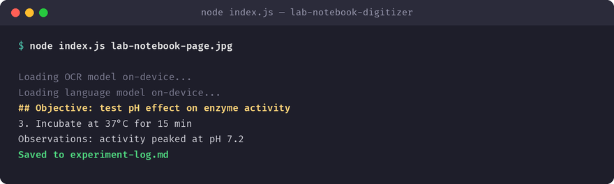

# lab-notebook-digitizer

OCRs a handwritten lab notebook page into a structured experiment log, on-device. Built with [Tether's QVAC SDK](https://github.com/tetherto/qvac) — the model runs on-device, so nothing leaves your machine.

## What it does

OCRs a handwritten lab notebook page into a structured experiment log, on-device.

**QVAC functions used:** `loadModel`, `ocr` and `completion`.



## Why I built it

Lab notebooks are the single source of truth and also completely unsearchable.

## Requirements

- Node.js >= 22
- `@qvac/sdk` `^0.19.0` (installed automatically via `npm install`)

## Install

```bash
git clone https://github.com/nafred001-code/lab-notebook-digitizer.git
cd lab-notebook-digitizer
npm install
```

## Run

```bash
node index.js path/to/lab-notebook-page.jpg
```

See the comments at the top of `index.js` for the exact input this app expects. On first run, QVAC downloads the model it needs once and caches it locally; every run after that is fully offline.

## SDK version used

`@qvac/sdk` `0.19.1`

## License

MIT — see [LICENSE](LICENSE).
